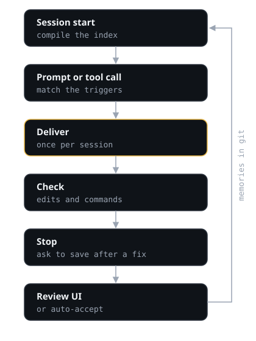

# How DD works

DD keeps knowledge an agent cannot derive from the code and delivers each piece at the action it applies
to. The behavioural contract is [`docs/DD.md`](../DD.md).

## The loop



1. **Compile.** At session start, DD compiles the project's memories into an index when they changed
   (`.dd/local/v2/index.json`). Session start injects nothing into the agent's context; it shows you one
   line with the number of live memories and how to open the review UI.
2. **Deliver.** At each prompt and before each tool call, a hook turns the event into its kind and paths
   (a read, an edit, a command…) and matches it against the triggers. The memories that match are added to
   the agent's context, once per session and subagent; a compaction or `/clear` re-arms them.
3. **Check.** Commands and edits are checked against the rules memories carry; at the end of the turn, the
   files the turn changed are checked once in their final state.
4. **Capture.** In a project that opted in (a `.dd/` folder: a committed `.dd/config.json`, or a first
   memory), DD records a footprint of the session: paths, redacted commands, outcomes, corrections. At the
   end of a turn that held a failure followed by a fix, or a correction from you, it asks the agent to
   save what it learned.
5. **Maintain.** Once a day, detached, DD rolls the session files up into local counters, prunes them after
   seven days and retires memories that never fire although their files keep being touched.

## What the agent receives

```text
DD - project knowledge (tests/store.test.js):
[TRAP] Close stores in t.after - A test that opens a store must close it in t.after: …
DD - advisory: knowledge, not an order. Apply it unless the user explicitly asked for what it rules out; then do what the user asked and say which memory it departs from.
```

The last line closes every delivery and every check report: a memory is advice, and the request in front
of the agent outranks it.

A delivery is at most 10,000 characters; a memory that does not fit is named and arrives at its next
event. Stale evidence and disputed memories are marked. A check that fails says so with the file:

```text
DD - check (Close stores in t.after): This test opens a store without closing it in t.after. (tests/a.test.js)
```

## Saving knowledge

The agent saves a memory by writing a JSON file into `.dd/inbox/` (the `save` command tells it how). DD
ingests it in the same turn and answers:

- **stored as active**, when DD verified the evidence itself (a file it hashed, or a correction it recorded that names the memory and follows something the agent did),
  every trigger can fire, the memory has no check and duplicates nothing live (auto-accept, on by default);
- **stored as a candidate** for review, saying which condition was not met;
- **rejected** with reasons, for example generic advice, a missing `not_derivable` or a secret in the text.

When no trigger is given, DD suggests one from what the session touched. The agent's requests to archive or
revise a memory wait for a person in the review UI, and what DD activated on its own waits in the "Accepted
by DD" queue until a person marks it reviewed. The review UI's dashboard shows the capture funnel (asks,
proposals, stored, activated, rejected), and `deltadictum health` adds the rejection reasons and each
memory's fires by the trigger dimension that matched.

## Commands

| Command | Does |
|---|---|
| `/dd:save` | Saves knowledge from the conversation |
| `/dd:recall <topic>` | Runs `deltadictum recall` and shows what DD knows |
| `/dd:review` | Opens the review UI (`deltadictum ui`) |
| `deltadictum init [--project-id NAME]` | Opts the project in: writes `.dd/config.json`, `.dd/.gitignore` and `.dd/memories/`, and compiles |
| `deltadictum status`, `health`, `maintain`, `compile` | Counts, health signals, maintenance by hand, a fresh index |
| `deltadictum doctor` | Is DD working here: Node, the opt-in, the index, sessions recorded, maintenance, what needs a person; exit 1 on a problem |
| `deltadictum migrate [--dry-run]` | Converts a v1 store |
| `deltadictum import [--from DIR] [--dry-run]` | Turns `.claude/rules/` and `.cursor/rules/` files that name paths into memories; a second run updates the ones that changed |

## How it is measured

- **`npm run bench:v2`** replays the tool calls of a recorded agent trial through the matching engine, over
  the memories that trial was recorded against (archived ones included, as they were then), and reports
  which memories each task would receive, and the hook's latency.
- **The agent trial** (`src/eval/agent/run.js`) runs Claude Code on 15 tasks in this repository, each in a
  fresh clone, under several conditions: no project knowledge, DD v1, DD v2, the same knowledge as a guide
  named in `CLAUDE.md`, and the guide not named. It records resolution (the task's check, the full suite,
  lint), code quality (the task's requirements plus a blind judge), peak context, time and API cost.

The 2026-10 trial (Claude Sonnet 5.5; 30 DD v2 runs and 15 runs without knowledge on the same day; judge
Claude Opus 5.5):

| | No knowledge | DD v2 |
|---|---|---|
| Resolved | 93% | 93% |
| Code quality | 70% | 77% |
| Project requirements met | 78% | 100% |
| Peak context | 27.2k | 27.2k |
| Median time | 1.11 min | 1.09 min |
| Cost per task | $0.0895 | $0.0903 |

DD v2 delivered the task's key memory in every task that had one, with a median of two memories and about
600 tokens, and nothing on control tasks. Against their own-day baselines, DD v1 cost 46% more for 10
quality points, the referenced guide 7% more for 9 points, DD v2 1% more for 7 points. One project, one
model and small samples: treat these as direction, not as a promise for your project.

A second trial on the v2 code
([2026-10-14, Claude Opus 5.5 and Claude Haiku 5.5 at high effort](../benchmarks/2026-10-v2-trial-opus-haiku.md),
10 tasks, four conditions, blind judge and blind audit) met every project requirement in every condition with both models: on that codebase the rules the
memories carried could be reached by reading, so it measures what DD costs when it is not needed. DD v2
was the cheapest condition for both models (Opus −7% against no knowledge, Haiku −7%, a tie once the two
tasks only a DD clone could bench are set aside), used the least or near-least context, and delivered the
key memory in 13 of 14 runs, every one of them honoured; the guide named in CLAUDE.md was read in 6 and 7
of 10 runs, the unnamed one in 3 and 0.
